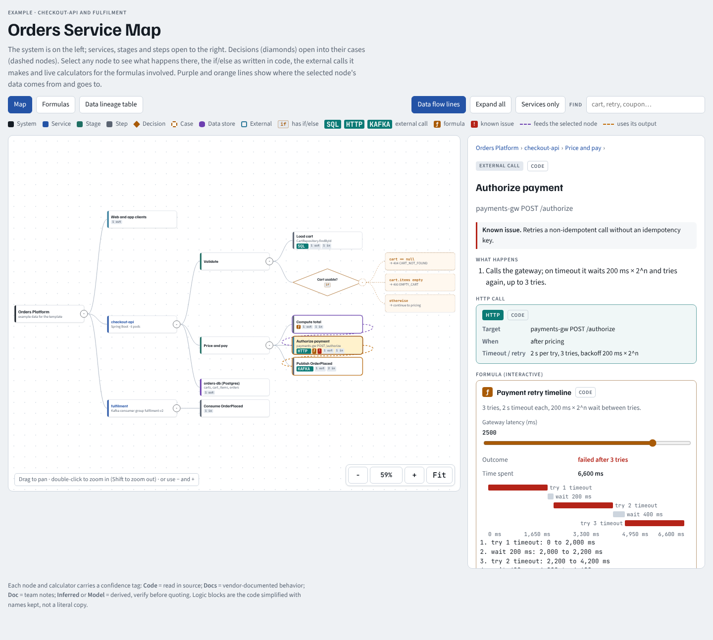
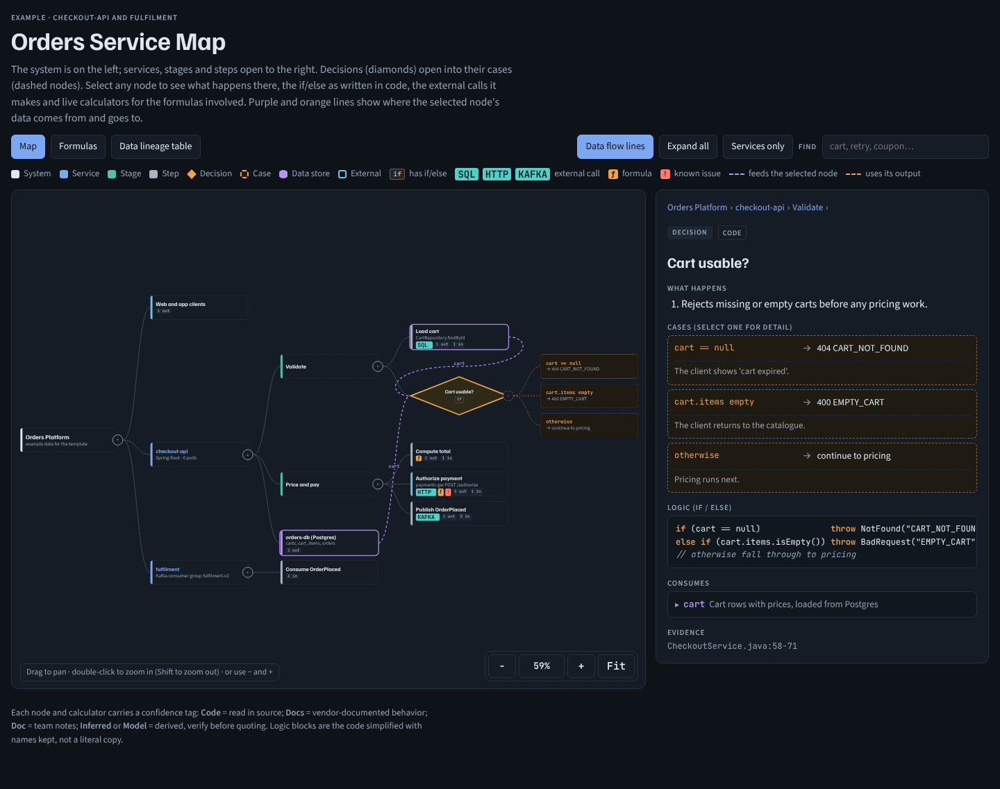
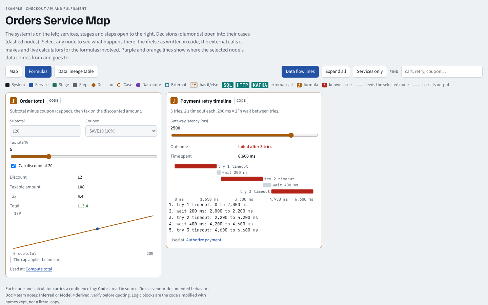

# repo-deep-dive

A skill for Claude that reads a codebase and turns it into an interactive **service map**: a collapsible tree of services, stages, steps and decisions. Every node explains what happens there, shows the if/else from the code, the external calls it makes, live calculators for the formulas involved, and where its data comes from and goes. On request, it also writes an **interview Q&A pack** grounded in the same code.



## What you get

**A service map**, as one HTML file that works offline:

- **Tree:** the system sits on the left and each level opens to the right. Click the root to expand or collapse everything.
- **Decisions:** drawn as diamonds that open into their cases.
- **Inspector:** for any node, it shows:
  - what happens, in order;
  - the logic as written in code;
  - cards for external calls (Elasticsearch, SQL, Kafka, Redis, HTTP and so on), with the request, timeout, retries and cache;
  - what the node consumes and produces, with links to the producers and consumers.
- **Calculators:** live formula calculators for scoring, decay curves, retry and backoff timelines, rate limits, cache TTLs and similar math.
- **Data flow:** flow lines for the selected node, a Formulas tab and a Data lineage table.
- **Navigation:** search, zoom buttons and double-click zoom (the mouse wheel scrolls the page), light and dark themes, and phone layouts.
- **Evidence:** a confidence tag on every node (`Code`, `Docs`, `Doc`, `Inferred`, `Model`, `Unknown`), plus file:line evidence.

**An interview Q&A pack** (optional), in Markdown. For each interview topic it gives five parts:
1. what your system does today;
2. the alternatives and why one wins;
3. cross-questions with model answers;
4. what to avoid saying;
5. the weak spots worth owning.

It also has a findings register, diagnosis drills and a day-by-day prep plan.

To see it before installing, download [`examples/orders-service-map.html`](examples/orders-service-map.html) and open it in a browser. It's a small map built from fictional data.



## Install

### Claude Code, as a plugin (recommended)

```bash
claude plugin marketplace add abhinav-08/repo-deep-dive
claude plugin install repo-deep-dive@repo-deep-dive
```

Inside a session you can run `/plugin marketplace add abhinav-08/repo-deep-dive` and then `/plugin install repo-deep-dive@repo-deep-dive` instead. The skill runs as `/repo-deep-dive:repo-deep-dive`, and Claude also uses it on its own when you ask for a service map.

### Claude Code, as a plain skill

```bash
git clone https://github.com/abhinav-08/repo-deep-dive.git
mkdir -p ~/.claude/skills
cp -R repo-deep-dive/plugins/repo-deep-dive/skills/repo-deep-dive ~/.claude/skills/
```

It then runs as `/repo-deep-dive` in every project. To limit it to one project, copy the folder into that project's `.claude/skills/` instead.

### claude.ai

```bash
git clone https://github.com/abhinav-08/repo-deep-dive.git
cd repo-deep-dive/plugins/repo-deep-dive/skills
zip -r repo-deep-dive.zip repo-deep-dive
```

Add `repo-deep-dive.zip` from **Customize > Skills** on claude.ai. Code execution must be turned on.

## Use

Ask in plain language, for example:

- "Map the orders-service repo end to end."
- "Make a service map of gateway and billing, including how they call each other."
- "Build interview prep from this repo. Here's the job description: ..."

Claude then works through these steps:

1. **Scope.** It agrees which repos to read and starts from their entry points.
2. **Fact register.** It records facts with file:line evidence and a confidence tag, and keeps the guesses visibly separate.
3. **Model.** It writes the map's data file.
4. **Build and check.** It builds the page and runs automated checks, which produce screenshots.
5. **Deliver.** It hands over `service-maps/<repo>/out/download/<repo>-service-map.html`. On claude.ai it can also publish the map as an artifact.

## Requirements

- **Python 3** for the build script (standard library only).
- **Node.js** (optional). When it's installed, the build also runs a JavaScript syntax check.
- **Playwright with Chromium** for the automated checks. Install it with `npm i -g playwright && npx playwright install chromium`.
- **A current browser** to view the map. It's tested in Chromium and uses modern CSS (`:has()`, `color-mix()`). Fonts load from Google Fonts when you're online, and fall back to system fonts offline.

## How it works

The page itself never changes per repo. Claude only writes data.

| File | Role |
|---|---|
| `assets/svcmap-template.html` | The page: layout, zoom, inspector, calculators, lineage. |
| `assets/sample-data.js` | A small fictional example that uses every field. |
| `scripts/build_svcmap.py` | Merges the template and data into the page plus an offline copy. It rejects broken data and runs a syntax check. |
| `scripts/check_svcmap.js` | Opens the page in headless Chromium and checks it (see below), saving screenshots for review. |

The checker covers:
- data integrity;
- overlaps with every node expanded;
- diamond click targets;
- zoom behavior;
- every calculator;
- light and dark themes;
- phone width.

The data file declares five objects:

- **`CFG`:** the page title and first view.
- **`D`:** the data items that flow between steps.
- **`N`:** the tree of nodes.
- **`EXTRA`:** the detail for each node: what happens, logic, external calls, case notes.
- **`FX`:** the calculators.

The full field reference is in [SKILL.md](plugins/repo-deep-dive/skills/repo-deep-dive/SKILL.md#data-contract).

To build and check the demo yourself:

```bash
cd plugins/repo-deep-dive/skills/repo-deep-dive
python3 scripts/build_svcmap.py assets/svcmap-template.html out/demo.html assets/sample-data.js \
  --title "Orders Service Map" --standalone out/demo-offline.html
NODE_PATH=$(npm root -g) node scripts/check_svcmap.js out/demo.html out/shots
```



## Customize

- **Look or behavior for every map:** edit `assets/svcmap-template.html`, then rebuild the demo and rerun the checker.
- **What Claude reads and how it models the map:** edit `SKILL.md`. The "Rules learned the hard way" section is a good place to add your own.

## Notes

- **The map is only as accurate as the reading behind it.** Every node carries a confidence tag. Check anything tagged `Inferred` before you rely on it.
- **Generated maps describe your code's internals.** Share them the way you would share the code.
- **One page holds about 250 nodes comfortably.** For larger systems, make one map per service group.

## Repository layout

```text
.claude-plugin/marketplace.json            marketplace entry for Claude Code
plugins/repo-deep-dive/
  .claude-plugin/plugin.json               plugin manifest
  skills/repo-deep-dive/
    SKILL.md                               the skill
    assets/svcmap-template.html
    assets/sample-data.js
    scripts/build_svcmap.py
    scripts/check_svcmap.js
examples/orders-service-map.html           prebuilt demo (fictional data)
docs/                                      screenshots
```

## License

No license has been chosen yet, so default copyright applies. You can read the code and try the demo here, but you need the author's permission to reuse or redistribute it. To ask, open an issue.
